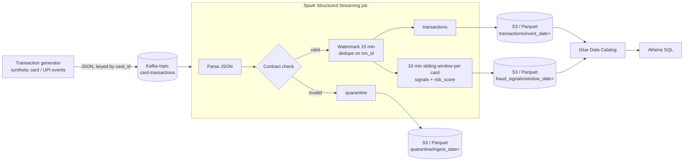

# kafka-spark-realtime-streaming

Real-time transaction streaming with Kafka and Spark Structured Streaming, landing to S3/Parquet with fraud-signal aggregation.


## Business scenario

A retail bank in India processes card and UPI payments around the clock. The fraud-operations
team wants **early warning signals within minutes**, not the next morning's batch report, and the
analytics team wants every transaction in the data lake, queryable with SQL.

This pipeline consumes the transaction feed from Kafka and, for every card, looks at a
**10-minute window that slides every 5 minutes** to raise five signals:

| Signal | Rule (default, configurable) | Typical fraud pattern |
|---|---|---|
| `VELOCITY` | ≥ 5 transactions in the window | Stolen card being drained quickly |
| `HIGH_VALUE` | ≥ ₹2,00,000 total in the window | Account takeover, big-ticket electronics |
| `MULTI_CITY` | ≥ 3 distinct cities in the window | Cloned card used in several places |
| `ATM_BURST` | ≥ 3 ATM withdrawals in the window | Skimmed card at ATMs |
| `CARD_TESTING` | ≥ 3 e-commerce payments under ₹100 | Fraudster probing whether a card works |

Each signal carries a weight. A window's `risk_score` is the sum of its weights, and windows scoring ≥ 50 are
`is_flagged` for review. These are **signals for a human or a downstream model**, not automatic blocks.

## Architecture



Locally Kafka runs in KRaft mode and MinIO stands in for S3. On AWS the same code runs on
MSK Serverless + EMR Serverless + S3 + Glue/Athena ([deployment guide](docs/aws-deployment.md), [Terraform](terraform/)).

## Repository layout

```
src/txnstream/
  config.py       thresholds + job settings (single source of truth)
  schema.py       JSON contract and validator
  rules.py        pure-Python reference implementation of the fraud rules
  transforms.py   the same logic as Spark DataFrame transformations
  job.py          streaming job: Kafka -> 3 Parquet sinks with checkpoints
  generator.py    synthetic transaction producer with labelled fraud scenarios
jobs/stream_job.py  spark-submit entry point
tests/            pytest: contract, rules, generator, Spark parity, streaming end-to-end
terraform/        S3, MSK Serverless, EMR Serverless, IAM, Glue table, Athena workgroup
sql/              example Athena queries
docker-compose.yml  local Kafka + MinIO + generator + Spark
```

## How to run

**Tests (no Docker, no AWS)**

```bash
python -m venv .venv && source .venv/bin/activate
pip install -r requirements-dev.txt
pytest -m "not spark"   # rules, contract, generator: under a second, no JVM needed
pytest                  # everything, including Spark tests (needs Java 17)
```

**Peek at the data**

```bash
PYTHONPATH=src python -m txnstream.generator --count 5 --seed 42
```

**Full local pipeline**

```bash
docker compose up -d --build
docker compose logs -f spark          # micro-batches every 30 s
```

- MinIO console: http://localhost:9001 (minioadmin / minioadmin), bucket `lake`
- Spark UI: http://localhost:4040
- Fraud windows appear under `lake/fraud_signals/` once the watermark passes a window (about 15–25 min of event time)
- `docker compose down -v` cleans everything up

**AWS**: see [docs/aws-deployment.md](docs/aws-deployment.md).

## Design decisions

- **Event time, not processing time.** Windows use `event_ts` with a 15-minute watermark, so a
  late-arriving POS batch still lands in the right window, and state is bounded.
- **Append mode only.** Each window is written once, after it is final. That keeps S3 free of
  rewrites and makes Athena results stable. The trade-off is a delay of window + watermark.
- **Dedupe inside the watermark.** Kafka producers retry, so the same `txn_id` can arrive twice.
  `dropDuplicatesWithinWatermark` removes it without keeping state forever.
- **Quarantine instead of drop.** Bad records keep their raw payload and a reason
  (`range:amount`, `domain:channel`, ...) so they can be fixed and replayed. Auditors can see nothing vanished.
- **Rules in one place, tested twice.** Thresholds live in `config.py`. `rules.py` is a plain-Python
  version of the Spark logic. A parity test asserts both produce the same windows, signals and scores,
  so rule changes can be unit-tested in milliseconds.
- **`collect_set` for distinct cities**, because `countDistinct` is not supported in streaming aggregations.
- **Kafka key = `card_id`**, so one card's events stay ordered within a partition.
- **Partitioning by date** plus Athena partition projection: no crawlers, no `MSCK REPAIR TABLE`.
- **Region `ap-south-1`**, since Indian card data is expected to stay in India.

### Known limitations and next steps

- Rules are static thresholds. A natural next step is per-customer baselines (for example amount z-score
  against a 90-day profile held in a lookup table) or scoring with a model.
- A 30-second trigger creates many small Parquet files. Run daily compaction or move the sinks to Apache Iceberg.
- Signals land in S3 only. For real-time alerting, also write flagged windows to a Kafka/SNS topic via `foreachBatch`.

## Interview Q&A

**1. Why do you need a watermark, and how did you pick 15 minutes?**
Without a watermark, Spark has to keep every window's state forever because a late event could still arrive.
The watermark tells Spark how late data can be. Windows older than `max(event_time) - 15 min` are finalised,
emitted (append mode) and dropped from state. 15 minutes is a trade-off between latency and completeness.
Measure real feed lateness (for example the p99 of `ingest_ts - event_ts`) and set it just above that.

**2. How do you avoid duplicates end to end?**
Three layers. Spark checkpoints Kafka offsets together with the sink's commit log, so the file sink is
exactly-once for a given input. Producer retries can still create duplicate *messages*, which
`dropDuplicatesWithinWatermark(["txn_id"])` removes. Downstream, `txn_id` is a natural key for merges.

**3. What happens if the job crashes in the middle of a micro-batch?**
On restart it reads the checkpoint (offsets + state store + sink metadata log), re-processes the
incomplete batch, and the file sink ignores files that were not committed in `_spark_metadata`.
On EMR Serverless, `--mode STREAMING` restarts the job automatically. Checkpoints are on S3.

**4. Sliding versus tumbling windows: why sliding here?**
With 10-minute tumbling windows, a burst from 10:08 to 10:12 is split across two windows and may never reach
the threshold. A 10-minute window sliding every 5 minutes means any 10-minute burst is caught by at least one
window that covers most of it. The cost is each event being counted in two windows (twice the state).

**5. Why MSK + EMR Serverless instead of Kinesis + Glue?**
The code is plain Kafka + Spark, so MSK keeps it portable and lets the same consumer run locally.
EMR Serverless gives a managed Spark runtime with control over the Spark version and packages.
Kinesis Data Streams + Glue Streaming would be a good choice if producers are already AWS-native and the team
prefers fewer moving parts. The transformation code would stay the same and only the source would change.
